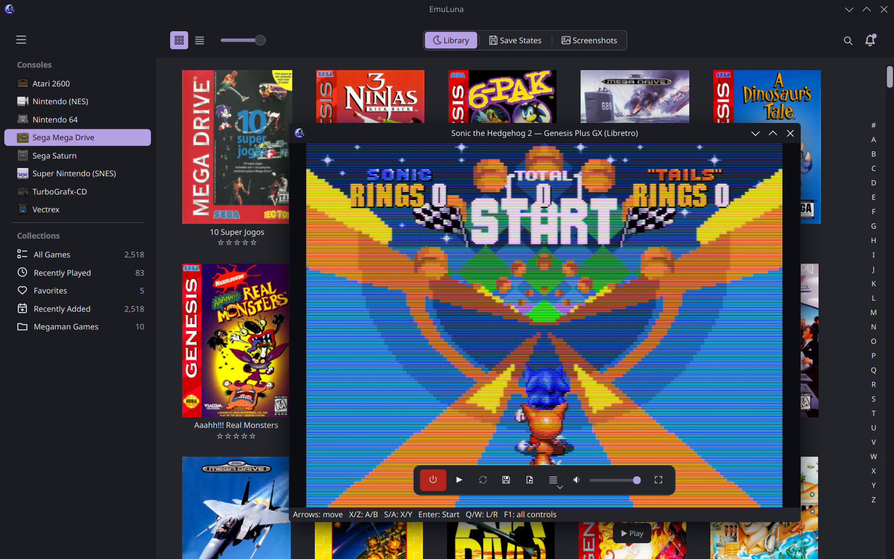

# EmuLuna

<p align="center">
  
</p>

[Website](https://emuluna-retro-library.turgo82.chatgpt.site/) ·
[GitHub releases](https://github.com/Turgo82/EmuLuna/releases)
<br>
<a href="https://www.buymeacoffee.com/turgo"></a>

EmuLuna is an independent Linux game library and libretro frontend inspired by OpenEmu. The Rust application is now the main development version, with native GPU presentation, controller configuration, themes, and a gameplay overlay.

## Build and run

Install Rust, CMake, Ninja, a C++ compiler, and the platform libraries described in [the Rust development guide](docs/RUST_DEVELOPMENT.md). Run:

```sh
./build.sh
./run.sh
```

`Launch EmuLuna.sh` opens the same Rust application. On first run, choose
`~/EmuLuna`, create the folder on another drive, or open a portable EmuLuna
library. Games, saved progress, BIOS files, and settings live under the chosen
root. The only system configuration entry is the location pointer in
`${XDG_CONFIG_HOME:-~/.config}/emuluna/library-location.json`.

To migrate the previous default library from the terminal, close EmuLuna and
run `./run.sh --migrate-library "$HOME/EmuLuna"`. The migration copies the
library, checks the new index, and switches to the new location. It keeps the
original for rollback. To relocate a portable library later, use **Settings →
Library → Move library…**.

Import games with **Library → Import games…**, the bottom-left **+**, Ctrl+O, or by dropping ROMs/folders into the window. Folder imports use Ctrl+Shift+O. The native importer follows the copy/external-file preference, copies managed files into the console library, skips duplicates, supports cartridge ZIPs, and keeps CUE/GDI/CCD/M3U disc sets together. Choose the console if a disc cannot be identified automatically.

**Library → Back up disc…** and **+ → Back up disc…** open the native physical-CD wizard. It uses the read-only Direct MMC helper, preserves CD audio tracks, and offers BIN/CUE or verified CHD output. CHD requires `chdman`; artwork conversion uses FFmpeg. The cdrdao compatibility reader and its 0–3 audio-checking levels are also available. Completed backups are added with **Done**. Hardware validation of this new port remains pending.

The main window remembers its normal size, position (when exposed by the window manager), and maximized state. Download the Linux AppImage from [GitHub releases](https://github.com/Turgo82/EmuLuna/releases).

## Source layout

- `apps/` and `crates/`: active Rust application and shared crates.
- `Cargo.toml`: root Rust workspace.
- `tools/`: development and validation scripts.
- `native/`: shared native libretro host and CHD support, used by Rust.
- `data/`: active artwork, controller layouts, themes, core catalogs, and shader sources.
- `tests/`: native contract fixtures and ROM generators used by Rust validation.

See [Rust validation](docs/VALIDATION.md), [hands-on testing](docs/HANDS_ON.md), and [third-party notices](THIRD_PARTY_NOTICES.md). Existing parity/export developer scripts may consult archived Python code; the running Rust app does not load it.
